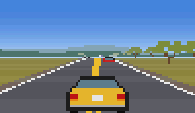
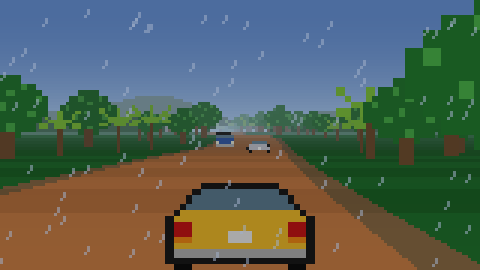
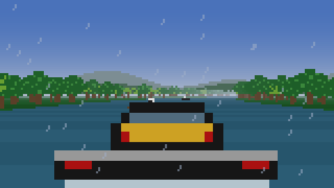
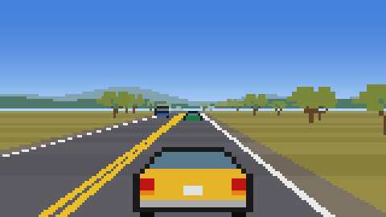
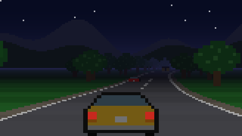
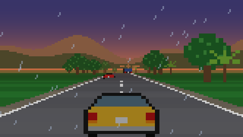
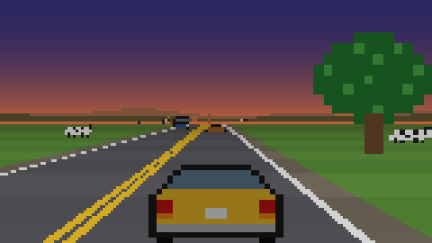

<div align="center">

# Oiapoque ao Chuí

**Um Fiat 147 atravessando o Brasil, em pixel art, no seu terminal.**

[](https://github.com/chmenegatti/oiapoque-chui/actions/workflows/ci.yml)
[](https://github.com/chmenegatti/oiapoque-chui/releases)
[](go.mod)
[](LICENSE)

[Página do projeto](https://chmenegatti.github.io/oiapoque-chui/) ·
[Como jogar](#como-jogar) ·
[A viagem](#a-viagem) ·
[Jogar por ssh](#jogar-por-ssh) ·
[Por dentro](#por-dentro)



</div>

São **5.713 km em 10 trechos**, por rodovias e cidades de verdade: chão de terra e chuva na BR-156, balsa pelo Amazonas, retas sem fim no cerrado, neblina na Serra do Cafezal e minuano no Banhado do Taim. Tudo desenhado com caracteres coloridos, a 60 quadros por segundo, num binário só.

O 147 é valente, mas é um 147: esquenta na subida, bebe gasolina, leva multa de radar e divide a pista simples com caminhão vindo de frente.

## Instalação

**Com Go 1.26+**

```bash
go install github.com/chmenegatti/oiapoque-chui@latest
oiapoque-chui
```

**Binário pronto** (Linux e macOS, amd64 e arm64): baixe em [releases](https://github.com/chmenegatti/oiapoque-chui/releases), descompacte e rode `./oiapoque-chui`.

**Do código-fonte**

```bash
git clone https://github.com/chmenegatti/oiapoque-chui
cd oiapoque-chui
go run .
```

### Terminal

- Precisa de **truecolor** e pelo menos **60×14** caracteres. Quanto maior a janela, mais resolução: cada caractere vira dois pixels.
- **Recomendado:** [Ghostty](https://ghostty.org), kitty, WezTerm, foot ou Alacritty recente. Eles avisam quando uma tecla é solta (protocolo de teclado do kitty), e o controle fica perfeito: soltou `↑`, o carro desacelera, mesmo no meio da curva.
- **Funciona também** no GNOME Terminal, Tilix, Konsole, xterm e parecidos, em modo compatível (veja [Teclado](#teclado)).
- Windows não é suportado por enquanto.

## Como jogar

| Tecla | Ação |
|---|---|
| `↑` / `w` | acelera (segure) |
| `↓` / `s` | freia |
| `←` `→` / `a` `d` | dirige |
| `c` | piloto de velocidade: acelerador travado; `↓` ou `c` desliga |
| `p` | pausa |
| `g` | chama o guincho (na pane seca) |
| `r` | recomeça o trecho do início (na pane seca) |
| `q` / `Esc` | salva e volta ao menu; no menu, sai |

O jogo salva sozinho a cada cidade, ao fim de cada trecho e quando você sai. O menu mostra "parado no km X" e o `Enter` continua dali. O save fica em `~/.config/oiapoque-chui/save.json`.

### Teclado

Terminal comum não avisa quando você solta uma tecla e só repete a última apertada. Por isso:

- **Com o protocolo do kitty** (Ghostty, kitty, WezTerm, foot, Alacritty): o jogo pede ao terminal os eventos de "soltou" e usa o estado real das setas. O menu mostra `teclado: protocolo kitty ✓`.
- **Modo compatível** (GNOME Terminal, Tilix, Konsole…): segurando `↑` o carro acelera. Se você vira com `↑` apertado, o jogo entende que `↑` continua apertado enquanto você vira. Soltou tudo, desacelera. Se soltar só a direção e continuar segurando `↑`, aperte `↑` de novo, porque o terminal não volta a repetir a tecla.

## A viagem

| # | Trecho | Via | Pista | km | Terreno |
|---|---|---|---|---:|---|
| 1 | Oiapoque → Macapá | BR-156 | simples | 590 | terra com chuva, Floresta Amazônica, lavrados do Amapá |
| 2 | Santana → Belém | balsa | rio | 330 | Rio Amazonas, Estreitos de Breves, Baía do Guajará |
| 3 | Belém → Imperatriz | BR-010 Belém-Brasília | simples | 620 | floresta, ondulado |
| 4 | Imperatriz → Palmas | BR-010 / BR-153 | simples | 610 | cerrado com fumaça de queimada |
| 5 | Palmas → Brasília | BR-153 / BR-060 | simples | 900 | cerrado, retas sem fim |
| 6 | Brasília → Uberlândia | BR-040 / BR-050 | dupla | 430 | cerrado, chuva de verão no Triângulo |
| 7 | Uberlândia → São Paulo | BR-050 / SP-330 Anhanguera | dupla | 590 | canaviais, trânsito pesado |
| 8 | São Paulo → Curitiba | BR-116 Régis Bittencourt | dupla | 408 | Serra do Cafezal, Vale do Ribeira, Serra do Azeite |
| 9 | Curitiba → Porto Alegre | BR-376 / BR-101 | dupla | 710 | Serra do Mar, litoral catarinense |
| 10 | Porto Alegre → Chuí | BR-116 / BR-471 | simples | 525 | pampa, Banhado do Taim |

Cada trecho leva de 7 a 13 minutos; a viagem inteira, umas 2 horas. O relógio do jogo anda junto: você sai de Oiapoque de manhã e pega pôr do sol, noite e madrugada pelo caminho. Os quilômetros das cidades são aproximados.

<table>
<tr>
<td></td>
<td></td>
<td></td>
</tr>
<tr>
<td align="center">BR-156, Amapá</td>
<td align="center">Rio Amazonas</td>
<td align="center">BR-153, cerrado</td>
</tr>
<tr>
<td></td>
<td></td>
<td></td>
</tr>
<tr>
<td align="center">Serra do Cafezal, 21h</td>
<td align="center">BR-101, Santa Catarina</td>
<td align="center">Pampa, a caminho do Taim</td>
</tr>
</table>

## O que a estrada pede

**Combustível.** Tanque de 38 litros, que passa de um trecho para o outro. Rende uns 10 km/l acelerando e 18 km/l embalado. O painel mostra a distância até o próximo posto, e a 2 km aparece o aviso. Para abastecer, freie e passe a menos de 25 km/h em frente à bomba: enche e cobra o preço da região (de R$ 6,00 a R$ 7,40 o litro). Acabou a gasolina e parou, é pane seca: guincho por R$ 300 com 8 litros, ou recomeçar o trecho.

**Temperatura.** Sobe com o pé embaixo, com a velocidade e principalmente na subida; esfria à noite e embalado. Passou de 118°, o motor ferve: metade da potência e vapor saindo do capô até baixar de 95°.

**Mão dupla.** BR-156, Belém-Brasília, BR-153 e BR-471 são pista simples, com faixa amarela dupla e tráfego vindo de frente, de farol aceso à noite. Invadiu a contramão com alguém vindo, ouve buzina. Bateu de frente, o carro para na hora e a funilaria custa R$ 250. Caminhões e ônibus são lentos e largos; o tráfego faz fila atrás deles, e ultrapassar é achar brecha na contramão. Nas rodovias duplicadas as duas faixas seguem no mesmo sentido.

**Radar.** Dois quilômetros antes de cada cidade tem radar fixo, com placa de 80 km/h e aviso um quilômetro antes. Há tolerância de 10%; acima disso, as multas seguem a lei: R$ 130,16 (até 20% acima do limite), R$ 195,23 (até 50%) e R$ 880,41 (acima de 50%), arredondadas no jogo.

**Terreno e clima.** Terra limita a velocidade a uns 100 km/h e faz o carro escorregar na curva. Chuva escurece tudo e tira aderência. Subida segura, descida embala. Neblina na serra esconde o carro da frente até ele estar perto.

**Balsa.** Entre Macapá e Belém não tem estrada. O 147 sobe na balsa (passagem de R$ 180) e você pilota pelo rio, desviando de troncos e barcos.

**Dinheiro e oficina.** Você sai com R$ 500 e ganha um prêmio a cada destino, proporcional ao trecho. Entre um trecho e outro, a oficina do Seu Zé vende:

| Melhoria | Preço | Efeito |
|---|---:|---|
| Motor 1.3 envenenado | R$ 900 | +15 km/h de final e arranque 25% melhor, esquenta 10% mais |
| Radiador novo | R$ 400 | motor esquenta 20% menos |
| Tanque extra | R$ 350 | +12 litros |
| Pneus de chuva | R$ 450 | metade do escorregão na chuva e na terra |
| Farol de milha | R$ 250 | enxerga o dobro à noite |

## Jogar por ssh

O mesmo binário vira um servidor ssh, feito com [wish](https://github.com/charmbracelet/wish):

```bash
oiapoque-chui -ssh :2323     # no servidor
ssh -p 2323 servidor         # para jogar
```

- Cada conexão ganha a própria viagem e o próprio teclado (o protocolo do kitty funciona pela rede também).
- Quem entra com chave pública tem save em `saves/<fingerprint>.json`, no diretório onde o servidor roda. Sem chave, joga sem salvar.
- A chave do servidor é criada em `.ssh/oiapoque_chui_ed25519` na primeira execução.
- O servidor aceita qualquer pessoa e desconecta depois de 30 minutos parado. Para expor na internet, considere um limite de conexões (o wish tem middleware de rate limit) e rodar sem privilégios.
- As cores são enviadas em truecolor; terminais antigos sem suporte mostram cores erradas.

## Por dentro

**Pixels em texto.** Cada célula do terminal desenha dois pixels com o caractere `▀`: a cor de frente é o pixel de cima, a de fundo é o de baixo. O jogo desenha num framebuffer RGB e converte no fim de cada quadro (`render.go`).

**Estrada pseudo-3D.** A técnica clássica dos jogos de corrida de fliperama: a estrada é uma lista de segmentos com curva e altura, projetados de perto para longe, linha por linha, cortando o que fica atrás de morro (`road.go`, `draw.go`). Cenário e tráfego são sprites escalados pela perspectiva, desenhados de longe para perto.

**Rotas em dados.** Cada trecho é um JSON em `rotas/` com terreno por faixa de quilômetro, cidades, postos e clima. A estrada é gerada com seed fixa, então é sempre a mesma: o terreno define o caráter das curvas, morros, cores e vegetação (`route.go`). Postos e radares são colocados automaticamente a partir das cidades.

**Tráfego.** Carros, caminhões e ônibus nos dois sentidos, com fila atrás dos lentos e colisão "varrida" entre quadros, para que ninguém atravesse o jogador quando a velocidade relativa passa de um segmento por quadro (`traffic.go`).

**Teclado.** O [tcell](https://github.com/gdamore/tcell) liga só a parte básica do protocolo do kitty e descarta os eventos de soltar tecla. `input.go` fica entre o terminal e o tcell: pede ao terminal os tipos de evento, guarda o estado das setas e repassa ao tcell só o que ele entende. Ao sair, devolve o terminal como estava.

### Criar uma rota

Um arquivo novo em `rotas/` (a ordem dos trechos é a ordem alfabética dos arquivos):

```jsonc
{
  "nome": "BR-116",                 // aparece no painel
  "origem": "Porto Alegre",
  "destino": "Chuí",
  "pista": "simples",               // "simples" (mão dupla) ou "dupla"
  "modo": "",                       // "balsa" para trecho de rio
  "km_total": 525,
  "seed": 471,                      // muda a estrada gerada
  "escala": 20,                     // quantas vezes o hodômetro anda mais rápido que o real
  "saida": 15,                      // hora de partida
  "gasolina": 6.5,                  // R$/litro
  "premio": 0,                      // 0 = automático pelo tamanho do trecho
  "terreno": [
    {"ate_km": 30,  "tipo": "urbano"},
    {"ate_km": 525, "tipo": "pampa", "nevoa": 0.5, "chuva": 0.2, "nome": "Banhado do Taim"}
  ],
  "cidades": [{"nome": "Pelotas", "km": 260}, {"nome": "Chuí", "km": 525}],
  "postos": []                      // vazio = um depois de cada cidade e nunca mais de 80 km sem posto
}
```

Tipos de terreno: `urbano`, `ondulado`, `serra`, `bananal`, `terra`, `floresta`, `cerrado`, `pampa`, `litoral`, `rio`. `nevoa` e `chuva` vão de 0 a 1.

## Desenvolvimento

```bash
go test ./...                              # todos os testes
SNAP=1 go test -run TestSnap .             # imagens das cenas em snap/
DEMO=1 go test -run TestDemoGIF .          # regera docs/demo.gif (Go puro, sem dependências)
vhs demo.tape                              # grava o terminal real, com painel (precisa do vhs)
```

Os testes mais importantes:

- `TestCampanha`: um piloto automático faz os 10 trechos acelerando fundo, para no posto quando o tanque baixa e alivia quando o motor ferve. Garante que toda rota é vencível e mostra o balanço de tempo, gasolina, temperatura e multas.
- `TestFluxo` e `TestParada`: menu, oficina, balsa, guincho, pausa, save por cidade e continuar do mesmo km.
- `TestBatidaDeFrente`, `TestMaoCerta`, `TestFilaAtrasDoCaminhao`: tráfego em mão dupla.
- `TestFiltroKitty`, `TestSoltouDesacelera`, `TestHeuristicaCurva`: teclado.

| Arquivo | O que faz |
|---|---|
| `main.go` | entrada, flag `-ssh`, loop a 60 FPS |
| `screens.go` | menu, oficina, tela final, save |
| `game.go` | física, veículo e melhorias, combustível, temperatura, posto, radar, guincho, checkpoint |
| `traffic.go` | veículos, mão dupla, fila, buzina, colisões |
| `route.go` | carrega rotas, gera a estrada, terrenos, postos, radares e cenário |
| `road.go` | segmentos com curva e morro |
| `draw.go` | céu, chuva, neblina, serra no horizonte, farol, sprites, painel |
| `sprites.go` | pixel art em texto |
| `render.go` | framebuffer e conversão para `▀` |
| `input.go` | protocolo de teclado do kitty |
| `ssh.go` | servidor wish e adaptador de sessão ssh para o tcell |
| `rotas/` | os 10 trechos |
| `docs/` | página do projeto (GitHub Pages), GIF e imagens |

## Ideias para depois

- Eventos de estrada: buraco e atoleiro na BR-156, vaca na pista no pampa, lombada, pedágio, blitz.
- Rotas alternativas em alguns trechos, como BR-101 pelo litoral ou BR-116 pelo interior.
- Paradas regionais: tacacá em Belém, pequi em Goiás, pastel de rodoviária, chimarrão no Sul.
- Modo contra o relógio, com ranking local.
- Som de motor.

## Créditos

Feito por [Cesar Menegatti](https://github.com/chmenegatti) em Go, com [tcell](https://github.com/gdamore/tcell) e [wish](https://github.com/charmbracelet/wish). Toda a arte é original, desenhada em texto.

Projeto de fã, sem relação com a Fiat ou a Stellantis. "Fiat" e "147" são marcas dos seus donos.

## Licença

[MIT](LICENSE)
